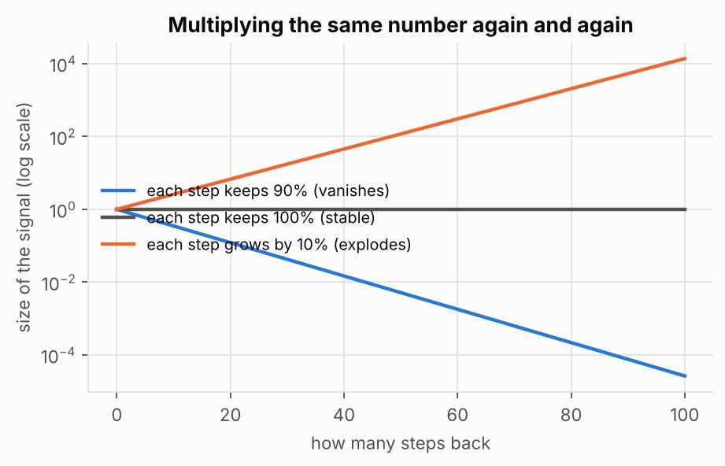

# 1. The Recurrent Neural Network (RNN)

## The problem it solves

You are reading: *"The students opened their ..."* To guess the next word, you need the words you have already read. An RNN is a network that **keeps a running memory of what it has read so far.**

Imagine reading a sentence one word at a time while keeping a **notepad**. At every word you do two things:

1. Look at the new word and your current notes.
2. Rewrite the notes to include the new word.

At the end, your notes are a summary of the whole sentence. The notes are the RNN's **hidden state**. The rewriting rule is the same at every word, which means the network reuses the same weights at every step. That is how it handles sentences of any length.

At each step the network takes the new input and the previous hidden state, and produces a new hidden state and an output.

### An example: predicting the next letter

Given "machin", the network is trained to predict "achine": at each position the target is simply the next letter.

## Ze math hehe

$$h_t=\tanh\big(W_x\,x_t+W_h\,h_{t-1}+b\big)$$

Read it left to right:

- $x_t$ is the new input (the current word as a vector).
- $h_{t-1}$ is the old notes (the previous hidden state).
- $W_x$ and $W_h$ are weights the network learns. They decide how much to pay attention to the new word versus the old notes.
- $\tanh$ squeezes the result into the range -1 to 1 so numbers stay tidy.
- $h_t$ is the new notes.

The key point: **$W_x$, $W_h$ and $b$ are the same at every step.** Only $x_t$ and $h_{t-1}$ change.

## How an RNN learns

Training is ordinary backpropagation, but over time: the network is "unrolled" so that each step looks like one layer of a deep network, the error is computed at the end, and the learning signal (the **gradient**) flows backwards through every step. This is called **backpropagation through time**.

## The big problem: forgetting

The learning signal has to travel back through every step, and at every step it gets multiplied by a number. Think of the **telephone game**: a message whispered through 100 people comes out garbled.

- If each step multiplies the signal by something a little below 1 (say 0.9), after 100 steps almost nothing is left: $0.9^{100}\approx 0.00003$. This is the **vanishing gradient**.
- If each step multiplies by something a little above 1 (say 1.1), the signal blows up: $1.1^{100}\approx 13{,}800$. This is the **exploding gradient**.

What this means in practice: a vanilla RNN learns from the last few words but struggles to connect words that are far apart. In *"The cat, which already ate a lot of food, was full"*, the model has to link "cat" to "was" across a long gap, and a plain RNN usually cannot.

- **Exploding** gradients are fixed with **gradient clipping**: if the gradient gets too big, scale it down to a maximum size.
- **Vanishing** gradients cannot be fixed that way. They need a new design, which is what LSTM and GRU are (next two files).

## Two useful variations

**Bidirectional RNN.** Sometimes you need words that come *after* a word to understand it. In *"He said, Teddy bears are on sale"* versus *"He said, Teddy Roosevelt was a great president"*, the first three words are identical and only the later words tell you whether "Teddy" is a toy or a person. A bidirectional RNN runs one RNN forward and one backward and combines them.

**Deep RNN.** Stack several RNN layers so that each layer reads the output of the layer below. Deeper stacks can learn more complex patterns, at the cost of being harder to train.

## Remember

- An RNN reads one step at a time and keeps a hidden state as memory.
- The same weights are reused at every step.
- Gradients vanish or explode because of repeated multiplication.
- Clipping fixes exploding. Vanishing needs LSTM or GRU.

## Check yourself

1. Why can an RNN handle sentences of different lengths?
2. What does $h_{t-1}$ represent?
3. Why is the telephone game a good picture of vanishing gradients?
4. When would you use a bidirectional RNN?

Answers

1. It reuses the same weights at every step, so it just runs for as many steps as there are words.
2. The memory (notes) the network built from everything it has read so far.
3. The learning signal is passed back through many steps and gets weaker each time, like a message getting garbled as it is passed along.
4. When the meaning of a word depends on words that come after it, and you have the whole sequence available (not live streaming).

## Useful links (highly recommend you guys read these links any of them :) )

- Andrew Ng, [Sequence Models, Week 1](https://www.coursera.org/learn/nlp-sequence-models) (RNN model, backprop through time, vanishing gradients)
- Chris Olah's diagrams of an RNN rolled and unrolled: [Understanding LSTM Networks](https://colah.github.io/posts/2015-08-Understanding-LSTMs/) (first section)
- Andrej Karpathy, [The Unreasonable Effectiveness of Recurrent Neural Networks](https://karpathy.github.io/2015/05/21/rnn-effectiveness/)
- StatQuest, [Recurrent Neural Networks (written tutorial)](https://lightning.ai/pages/community/tutorial/recurrent-neural-networks/)
- Distill, [Visualizing memorization in RNNs](https://distill.pub/2019/memorization-in-rnns/) (interactive: see how far back a model actually looks)
- Video: [StatQuest, RNNs Clearly Explained](https://www.youtube.com/results?search_query=StatQuest+Recurrent+Neural+Networks+RNNs+Clearly+Explained) (search link)

