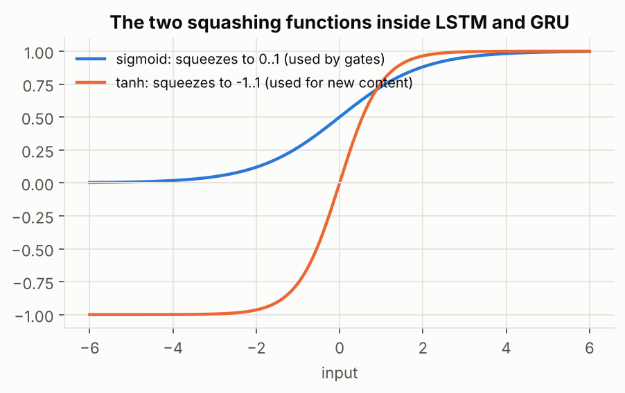

# 2. LSTM (Long Short-Term Memory)

## The problem it solves

A plain RNN **rewrites its whole notepad at every word**. Anything important you wrote ten words ago is likely overwritten or faded. The LSTM gives the network a better way to manage memory.

## The idea in plain words

Give the network two kinds of memory:

- **Cell state** (long-term memory): a notebook that runs straight through the whole sequence like a conveyor belt. Information can ride on it unchanged for a long time.
- **Hidden state** (working memory): what the network is currently using to make its output.

Then add three **gates**. A gate is a volume knob with a value between 0 (block everything) and 1 (let everything through):

| Gate | What it decides | Everyday picture |
|---|---|---|
| **Forget gate** | What to erase from the notebook | an eraser |
| **Input gate** | What new information to write into the notebook | a pen |
| **Output gate** | What part of the notebook to use right now | a reading light |

Gates get their 0-to-1 values from a **sigmoid** function. The new content to be written is squeezed by **tanh** (range -1 to 1).

## One LSTM step, broken down

The picture below is one LSTM step. Read it in four pieces. Each piece uses the new input and the previous hidden state.

**Step 1: compute the three gates** (input, forget, output), each a 0-to-1 knob.

**Step 2: compute the candidate** (the new content that *could* be written).

**Step 3: update the notebook.** Erase some of the old content (forget gate), and write some of the new content (input gate).

**Step 4: decide what to show.** The output gate picks which part of the notebook becomes the new hidden state.

https://distill.pub/2019/memorization-in-rnns/
https://colah.github.io/posts/2015-08-Understanding-LSTMs/
useful links for visual reference

## Ze math hehehe

Here $c_t$ is the notebook (cell state) and $h_t$ is the working memory (hidden state); $\odot$ means multiply element by element:

$$c_t = f_t\odot c_{t-1} + i_t\odot \tilde c_t \qquad\qquad h_t = o_t\odot\tanh(c_t)$$

- $f_t$, $i_t$, $o_t$ are the forget, input and output gates.
- $\tilde c_t$ is the candidate (the new content).
- First equation in words: **new notebook = (keep part of the old) + (write part of the new).**
- Second equation in words: **working memory = the part of the notebook the output gate lets through.**

Each gate is computed the same way: apply weights to the new input and the old hidden state, then sigmoid. You do not need to memorise the weight names.

## Why it remembers longer

The notebook is updated by **adding** (keep some old + add some new). A plain RNN **rewrites** its memory completely. If the forget gate stays near 1 and the input gate near 0, the old information passes through untouched, like a message that travels along a conveyor belt instead of being whispered through 100 people. The learning signal flows backwards along the same belt, so it does not fade nearly as fast.

**Example:** *"The cat, which already ate a lot of food, was full."* When the network reads "cat", it writes "singular" into the notebook. The forget gate keeps it through all the words in between. When it reaches "was", that information is still there.

- The LSTM has about four times the weights of a plain RNN with the same size (the three gates and the candidate each have their own).
- A common trick: start the forget gate biased toward 1 so the network remembers by default.
- LSTMs can still lose information over very long sequences, and gradient clipping is still used.
- Cell state is long-term memory; hidden state is working memory.
- Three gates: forget (erase), input (write), output (reveal).
- Memory is updated by adding, not rewriting, which keeps information and gradients alive longer.

## Check yourself

1. Which gate would you close to make the network forget the previous sentence?
2. Why are gates built with sigmoid?
3. Why does adding instead of rewriting help gradients?

Answers

1. The forget gate (set near 0 for the old memory).
2. Sigmoid outputs a number between 0 and 1, which works as a "how much to let through" knob.
3. The old information, and the learning signal, can flow through unchanged instead of being multiplied by a small number at every step.

## Useful Links

- Andrew Ng, [Sequence Models, Week 1: LSTM](https://www.coursera.org/learn/nlp-sequence-models)
- Chris Olah, [Understanding LSTM Networks](https://colah.github.io/posts/2015-08-Understanding-LSTMs/) (the standard explanation)
- Michael Phi, [Illustrated Guide to LSTM's and GRU's](https://towardsdatascience.com/illustrated-guide-to-lstms-and-gru-sa-step-by-step-explanation-44e9eb85bf21)
- [LSTM Explained: How Neural Networks Remember Long-Term Information](https://pub.towardsai.net/lstm-explained-how-neural-networks-remember-long-term-information-ee210d10f0cf) (Towards AI)
- Video: [StatQuest, LSTM Clearly Explained](https://www.youtube.com/results?search_query=StatQuest+Long+Short-Term+Memory+LSTM+Clearly+Explained) (search link)
- Paper: Hochreiter and Schmidhuber 1997, [Long Short-Term Memory](https://doi.org/10.1162/neco.1997.9.8.1735)

