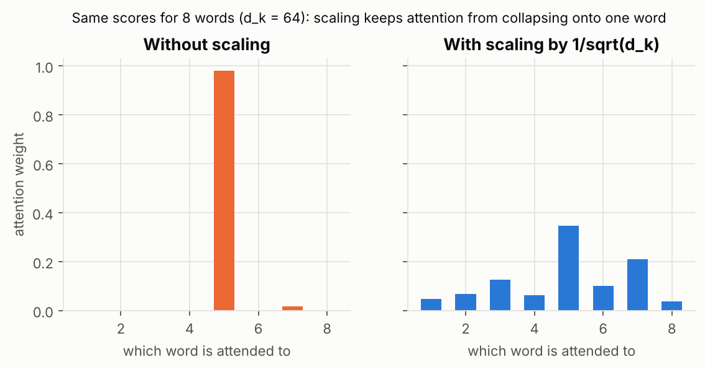

# 6. Self-Attention, Multi-Head Attention and the Transformer

RNNs, LSTMs and GRUs read one word at a time, so they cannot be sped up by running steps in parallel, and information still has to travel through many steps to link distant words. **Self-attention** lets every word look directly at every other word in the same sentence, all at once.

Take: *"The animal didn't cross the street because it was too tired."* What does "it" refer to? You know it is "the animal". Self-attention lets the model work that out: when it processes "it", it gives high weight to "animal" and uses that word's meaning to enrich the representation of "it".

While encoding "it", attention links it to "The Animal".

It is the same attention you learned in file 5, with one difference: the queries, keys and values all come from the **same sentence**.

## Self-attention step by step

For each word, the model makes three versions of its vector using three learned weight matrices:

- a **query** (what this word is looking for),
- a **key** (what this word offers to be matched against),
- a **value** (the information this word hands over if it is chosen).

Then, for one word (say "Thinking"):

1. **Score** it against every word: multiply its query with each word's key.

2. **Scale and softmax** the scores into weights that sum to 1.

3. **Mix:** multiply each word's value by its weight and add them up. That sum is the new representation of the word.

In practice all words are processed at once with matrix multiplication, which is why this is fast on GPUs.

## math - time - :) - again

$$\mathrm{Attention}(Q,K,V)=\mathrm{softmax}\!\left(\frac{QK^{\top}}{\sqrt{d_k}}\right)V$$

Read it from the inside out:

- $QK^{\top}$: every query matched against every key, giving a table of scores.
- $\sqrt{d_k}$: the square root of the key vector's length, used to scale scores down (see below).
- softmax: scores become weights.
- times $V$: take the weighted mix of the values.

**Why divide by $\sqrt{d_k}$?** When vectors are long, dot products get large. Large scores make softmax almost "winner takes all", so one word gets nearly all the weight and the rest get almost none, which also makes learning hard. Dividing keeps scores in a sane range:

## Multi-head attention

One round of attention can only focus on one pattern at a time. **Multi-head attention** runs several attention operations in parallel, each with its own query, key and value weights, and combines the results. Think of several readers going through the same sentence, one watching for "who did it", another for "when", another for "what it refers to". Andrew Ng describes it as asking several different questions about each word at once.

Heads run in parallel, are concatenated, then mixed by one more linear layer.

The original Transformer used 8 heads. ooh.

## Two small but important extras

- **Masking:** when a decoder generates text, it must not peek at future words. A **causal mask** blocks attention to words that come later.
- **Residual connections and layer norm:** shortcuts and normalisation wrapped around each block so deep stacks train stably.

## Self-attention versus RNNs

| | RNN, LSTM, GRU | Self-attention |
|---|---|---|
| Processing | one word after another | all words at once |
| Distance between two far-apart words | many steps | one step |
| Training speed | slow (cannot parallelise over time) | fast (parallel) |
| Cost as the sentence gets longer | grows linearly | grows with the square of the length |
| Knows word order? | yes, built in | **no**, must be added (next file) |

## The Transformer, at a glance

A Transformer stacks the pieces you now know: embeddings, then repeated blocks of multi-head self-attention plus a small feed-forward network (each wrapped with residuals and layer norm), with an encoder half that reads and a decoder half that writes.

You can now name almost every box in that picture. The one still missing: **positional encoding**, how it knows word order.

- Self-attention: every word attends to every word in the same sentence.
- Query = looking for, key = offering, value = information passed on.
- Formula: softmax of scaled query-key scores, applied to the values.
- Multi-head = several attentions in parallel looking for different patterns.
- It is fast and parallel but has no sense of order on its own.

## Check yourself

1. How does self-attention differ from the attention in file 5?
2. Why do we divide the scores by $\sqrt{d_k}$?
3. What does multi-head attention add?
4. What does a causal mask prevent?

Answers

1. Queries, keys and values all come from the same sentence instead of from decoder and encoder.
2. To keep dot products from growing with vector length and pushing softmax into winner-takes-all.
3. Several attention patterns at once, so different heads can capture different relationships.
4. Looking at future words while generating.

## Useful stuff

- Video: [3Blue1Brown, Attention in transformers, step by step](https://www.youtube.com/results?search_query=3Blue1Brown+attention+in+transformers+step-by-step) (search link; about 26 minutes)
- Video: [Andrej Karpathy, Let's build GPT: from scratch, in code, spelled out](https://youtu.be/kCc8FmEb1nY)
- Interactive: [Transformer Explainer](https://poloclub.github.io/transformer-explainer/) (GPT-2 in your browser), with a [walkthrough video](https://www.youtube.com/watch?v=ECR4oAwocjs)
- Paper: Vaswani et al. 2017, [Attention Is All You Need](https://arxiv.org/abs/1706.03762)

