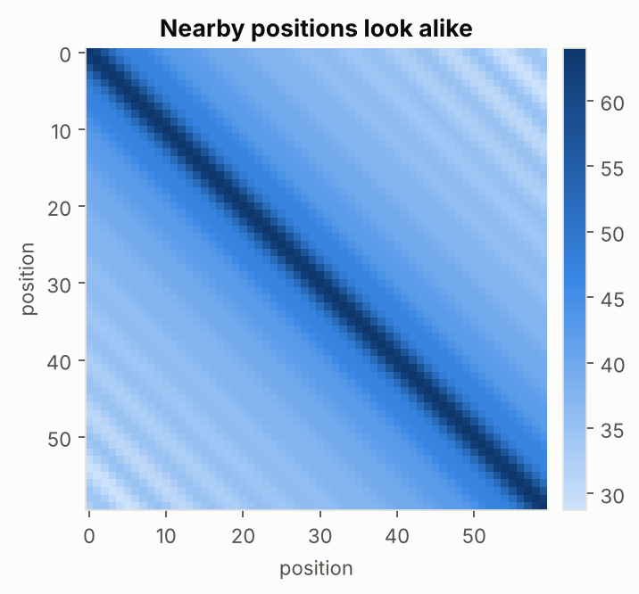

# 7. Positional Encoding

Self-attention looks at all words at once as a *set*. If you shuffle the words, the model's computation for each word is the same, just in a different order. To the model, "dog bites man" and "man bites dog" look identical. RNNs get order for free by reading step by step; a Transformer has to be **told** where each word sits.

## The simple idea

Give every position its own list of numbers (a **position code**) and **add** it to the word's embedding before the first layer. Now each vector carries both *what the word is* and *where it is*.

A position vector is added to each word embedding.

**Why not just add the number 1, 2, 3, ...?** The values would grow without limit, the model would meet longer sentences than it ever trained on, and the numbers would swamp the word meaning. **And why not scale positions to 0-to-1?** Then a step of 0.1 means one word in a 10-word sentence but five words in a 50-word one.

A good position code should be unique for each position, stay small, work for any sentence length, and make "how far apart" easy to compute.

## The clock analogy (sinusoidal encoding)

Think of a clock with hour, minute and second hands. Each hand moves at a different speed, but together the three positions identify the time uniquely. Positional encoding does the same with waves: each pair of numbers in the code is a sine and cosine wave of a different **speed**. Some waves oscillate quickly (like a second hand), others very slowly (like an hour hand). The combination of all of them is unique for every position, and it stays between -1 and 1.

Each row is the position code for one word of a 20-word sentence, with 512 numbers per row. In this version the left half holds the sine values and the right half the cosine values; within each half, the pattern changes quickly on the left and slowly toward the right.

For a cleaner heatmap and a line plot of a few dimensions, see these figures from Dive into Deep Learning (CC BY-SA 4.0):

Four dimensions of the code plotted against position: different columns oscillate at different speeds.

Rows are positions, columns are encoding dimensions.

## You know what time is it :P

$$PE_{(pos,\,2i)}=\sin\!\Big(\frac{pos}{10000^{2i/d}}\Big),\qquad PE_{(pos,\,2i+1)}=\cos\!\Big(\frac{pos}{10000^{2i/d}}\Big)$$

- $pos$ is the word's position (0, 1, 2, ...).
- $i$ picks which pair of numbers in the code we are filling. Larger $i$ means a bigger divisor, hence a **slower** wave.
- $d$ is the size of the embedding.
- Even-numbered entries use sine, odd-numbered entries use cosine.

**Tiny example** with a 4-number code (two waves, speeds 1 and 1/100):

| position | position code |
|---|---|
| 0 | [0, 1, 0, 1] |
| 1 | [0.84, 0.54, 0.01, 1.00] |
| 2 | [0.91, -0.42, 0.02, 1.00] |

The first pair changes quickly with position (the second hand); the second pair barely moves (the hour hand).

## Why sine and cosine tho?

- Values are **bounded** between -1 and 1, so they never swamp the embedding.
- It works for **any length**, even longer than training sentences, because it is a formula, not a lookup table.
- Moving from position $p$ to $p+k$ is the same **rotation** for every $p$, which makes it easy for the model to learn "pay attention to the word 3 positions back".
- Nearby positions get similar codes and far-apart positions get less similar codes:

## Other ways to encode position

| Method | Idea |
|---|---|
| Learned positions | the model learns a vector per position, like a word embedding (BERT, GPT-2); simple, but limited to the lengths seen in training |
| Relative positions | encode the **distance** between two words instead of absolute positions |
| RoPE (rotary) | rotate each query and key by an angle that grows with position, so the attention score depends on how far apart two words are; used in many recent large language models |
| ALiBi | subtract a penalty that grows with distance from the attention scores |

- Self-attention has no sense of order, so position must be added.
- The sinusoidal code is a fixed set of waves at different speeds, added to the embeddings.
- It is bounded, unique per position, and works for any length.
- Newer models often use relative methods such as RoPE.

## Check yourself

1. Why does an RNN not need positional encoding but a Transformer does?
2. Is the sinusoidal positional encoding learned?
3. Why is adding the plain number 1, 2, 3 a bad idea?
4. In the clock analogy, what plays the role of the hour hand?

Answers

1. An RNN reads in order, so order is built in; self-attention treats words as an unordered set.
2. No, it is a fixed formula.
3. Values grow without bound, fail on longer sentences, and drown out the word meaning.
4. The slowest wave (the pair of dimensions that changes very slowly with position).

## Learn more

- RoPE: [RoPE Clearly Explained](https://towardsdatascience.com/rope-clearly-explained/) (Towards Data Science), [A Deep Dive into RoPE](https://medium.com/@parulsharmmaa/understanding-rotary-positional-embedding-and-implementation-9f4ad8b03e32) (Medium)
- Video: [RoPE explained](https://www.youtube.com/results?search_query=RoPE+rotary+position+embedding+explained) (search link)
- Paper: Su et al. 2021, [RoFormer (RoPE)](https://arxiv.org/abs/2104.09864); Press et al. 2021, [ALiBi](https://arxiv.org/abs/2108.12409)

